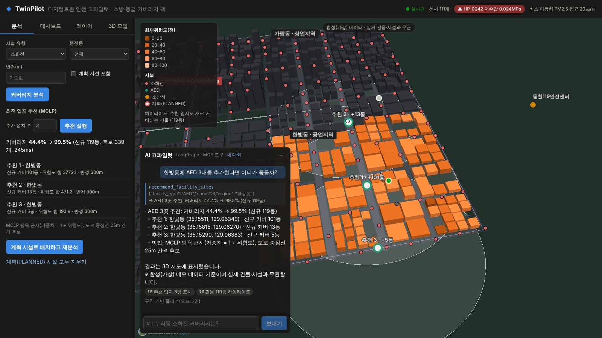
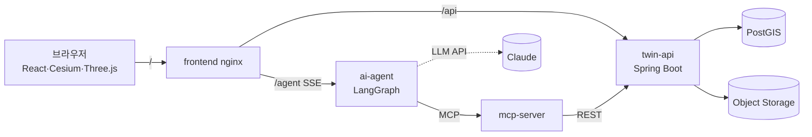
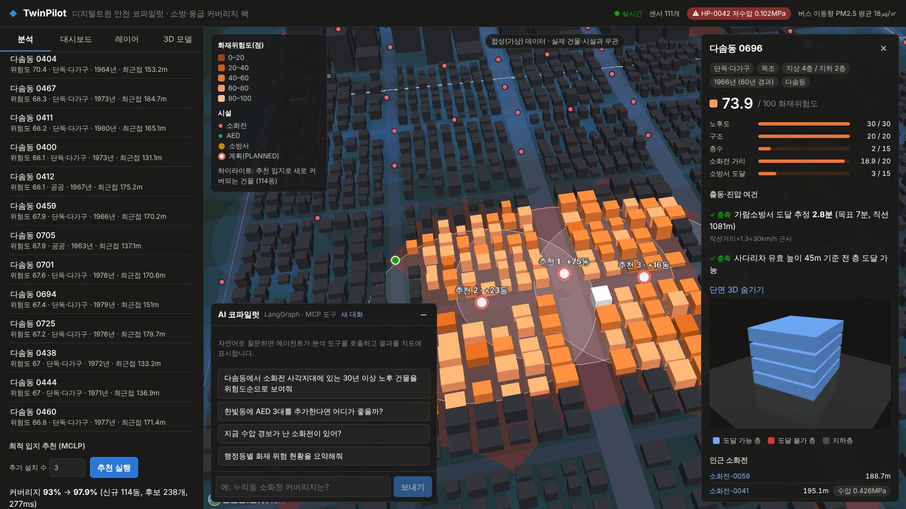
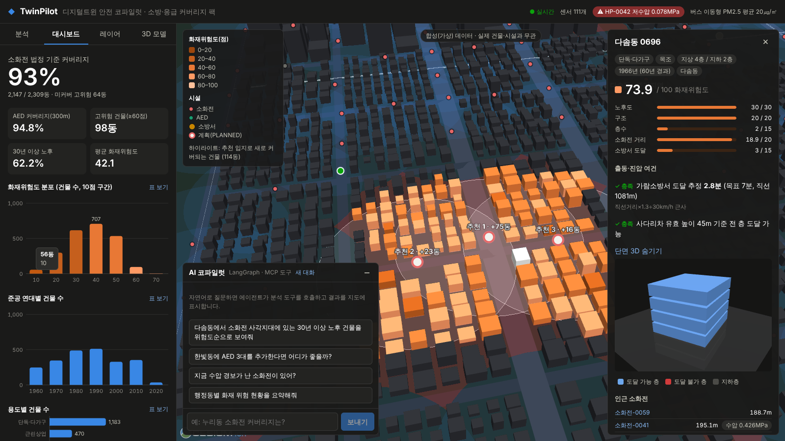
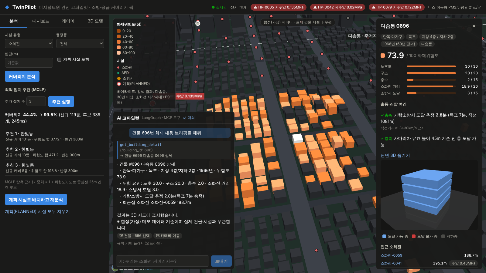
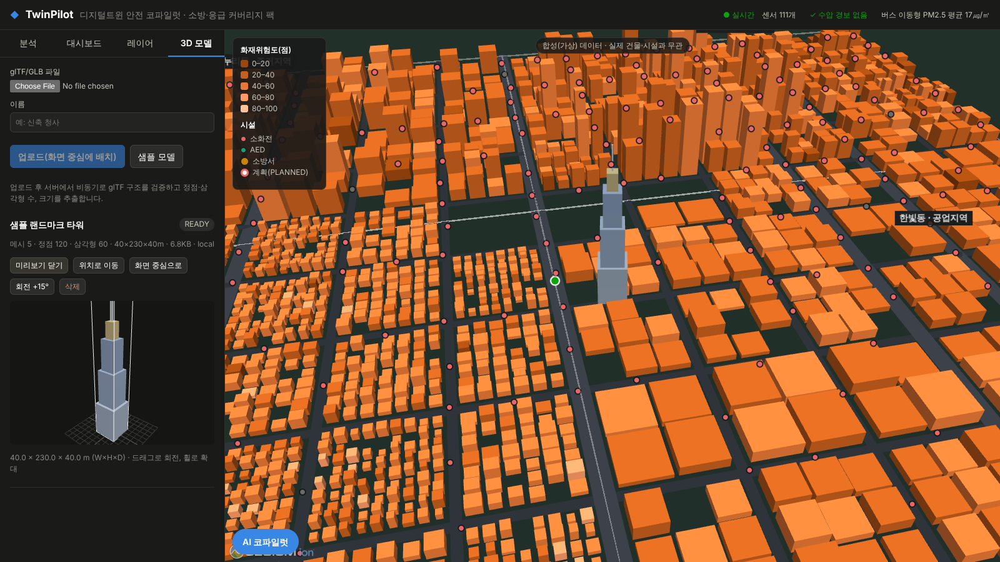

# TwinPilot — 디지털트윈 안전 코파일럿 (MVP)

> 자연어로 묻고 3D로 답하는 디지털트윈 의사결정 플랫폼.
> 첫 번째 분석 팩은 **소방·응급 안전 커버리지**다. 소화전·AED·소방서 커버리지, 사각지대, 최적입지, 건물 화재위험도, IoT 모니터링을 다룬다.

⚠️ 데모 데이터는 부산진구 일대 좌표에 생성한 **합성(가상) 도시**다. 실제 건물·시설과 무관하다.



## 구성

| 디렉터리 | 기술 | 역할 |
|---|---|---|
| `backend/` | Java 21, Spring Boot 4.1, JdbcClient, Flyway, PostGIS 3.5 | 공간 분석 REST API. 커버리지·사각지대·최적입지(MCLP)·위험도 계산, 비동기 Job과 SSE, IoT 센서 스트림, glTF 검증·저장(로컬/NCP Object Storage) |
| `frontend/` | React 19, TypeScript, CesiumJS 1.145, Three.js, TanStack Query, Zustand | 3D 트윈 지도(건물 2,309동을 Primitive로 일괄 렌더링), 분석·대시보드, 건물 층별 단면, glTF 뷰어, AI 코파일럿 UI |
| `mcp-server/` | MCP Python SDK(FastMCP), httpx | 분석 기능을 MCP 도구 8종·리소스 2종·프롬프트 1종으로 노출(Streamable HTTP / stdio) |
| `ai-agent/` | LangGraph, LangChain(ChatAnthropic, 기본 `claude-opus-5-5`), langchain-mcp-adapters, FastAPI | MCP 클라이언트 에이전트. 도구 호출, 지도 액션, 답변을 SSE로 스트리밍. 키가 없으면 규칙 기반 플래너로 동작 |
| `data/` | Python(표준 라이브러리) | 합성 도시 생성기(seed 고정), 샘플 GLB |
| `infra/` | Docker Compose, Kustomize, Terraform(ncloud), GitHub Actions | 로컬 스택, Kubernetes base/local/ncp 오버레이, NCP(VPC·NKS·Object Storage) IaC, CI |
| `docs/` | — | 조사·기획·아키텍처/운영·API·검증 문서 |



## 빠른 시작 (Docker Compose)

```bash
docker compose -f infra/docker-compose.yml up -d --build
open http://localhost:8088
```

- LLM 모드: 셸에 `ANTHROPIC_API_KEY`를 두면 에이전트가 `claude-opus-5-5`(effort medium, 서버 측 refusal fallback 사용)로 동작한다. 키가 없으면 같은 그래프와 MCP 경로를 쓰는 규칙 기반 플래너가 응답한다.
- TLS 검사 프록시(사내망 등) 뒤에서 빌드할 때는 CA 번들을 BuildKit secret으로 넘긴다: `docker build --secret id=extra_ca,src=ca.pem ...`
- Maven 저장소를 미리 받아 둔 경우 오프라인으로 빌드할 수 있다: `docker build --build-context m2repo=$HOME/.m2/repository --build-arg MAVEN_ARGS="-B -q -o" backend`

## 로컬 개발

```bash
# 1) PostGIS
docker run -d --name tp-postgis -e POSTGRES_USER=twin -e POSTGRES_PASSWORD=twin -e POSTGRES_DB=twinpilot -p 5432:5432 postgis/postgis:16-3.5
# 2) twin-api (첫 기동 시 합성 데이터 적재) → :8080, Swagger UI: /swagger-ui.html
cd backend && mvn spring-boot:run
# 3) MCP 서버 → :8090/mcp
cd mcp-server && pip install -e . && TWIN_API_URL=http://localhost:8080 python -m twinpilot_mcp
# 4) 에이전트 → :8000
cd ai-agent && pip install -e . && MCP_URL=http://localhost:8090/mcp uvicorn twinpilot_agent.app:app --port 8000
# 5) 프론트엔드 → :5173 (/api, /agent 프록시)
cd frontend && npm install && npm run dev
```

Claude Desktop 등 외부 MCP 클라이언트에서는 `python -m twinpilot_mcp --transport stdio`를 등록해 같은 도구를 쓸 수 있다.

합성 데이터 재생성: `python3 data/generate_synthetic_city.py` (seed 고정)

## 테스트

| 대상 | 명령 | 결과(2026-10-09) |
|---|---|---|
| backend | `mvn test` (Testcontainers PostGIS) | 15 통과 |
| frontend | `npm run typecheck && npm test` | 타입 검사 통과, 9 통과 |
| mcp-server | `pytest` (`TWIN_API_URL` 지정 시 실서버 연동 포함) | 7 통과 |
| ai-agent | `pytest` (`TEST_CHECKPOINT_DB_URL` 지정 시 PostgreSQL 체크포인터 포함) | 26 통과 |
| E2E | Playwright(헤드리스 Chromium) 9개 화면 시나리오 | 통과, 콘솔 오류 0 |
| Kubernetes | kubeconform + kube-apiserver 적용·dry-run | 48/48 스키마 통과, 21개 적용, 27/27 dry-run |

측정값과 검증 범위, 검증하지 못한 항목은 [`docs/05-verification.md`](docs/05-verification.md)에 있다.

## 문서

2. [서비스 기획](docs/02-service-plan.md): 문제 정의, 페르소나, 기능 명세, 분석 로직, 아키텍처, 로드맵
3. [아키텍처·운영](docs/03-architecture-ops.md): 비동기·성능 설계, 보안, Kubernetes·NCP 배포 절차
4. [API](docs/04-api.md): REST, SSE, MCP 도구, 에이전트 이벤트, 지도 액션 스키마
5. [검증 결과](docs/05-verification.md): 테스트·E2E·성능 측정, 미검증 항목

## 화면

| 커버리지·사각지대 | 건물 상세(위험 요인·Three.js 단면) |
|---|---|
|  |  |
| **최적입지 추천(비동기 Job)** | **대시보드** |
|  |  |
| **코파일럿 건물 브리핑** | **glTF 업로드·배치·미리보기** |
|  |  |

## 데이터·라이선스 고지

- 합성 데이터는 `data/generate_synthetic_city.py`가 만든다. 실제 공공데이터(건축물대장, 소방용수시설)는 같은 스키마의 GeoJSON으로 적재하도록 설계했다.
- OSM 배경지도(선택)는 © OpenStreetMap contributors. 기본 배경은 Cesium 내장 NaturalEarthII다.
- 분석 기준 중 소화전 반경(100m/140m)은 소방기본법 시행규칙 [별표 3]을 따른다. AED 반경, 주행속도, 사다리차 높이는 **가정값**이며 설정으로 바꿀 수 있다.
