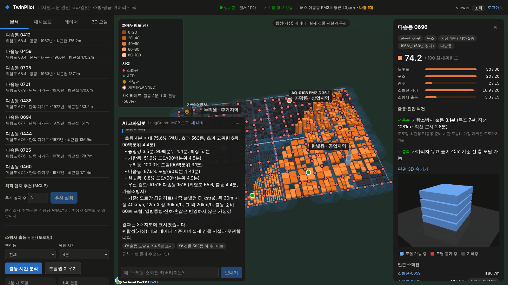
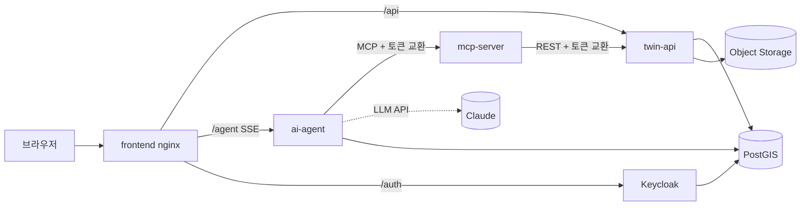
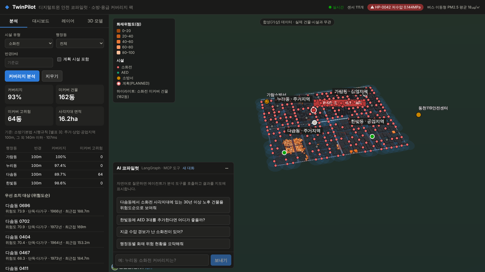
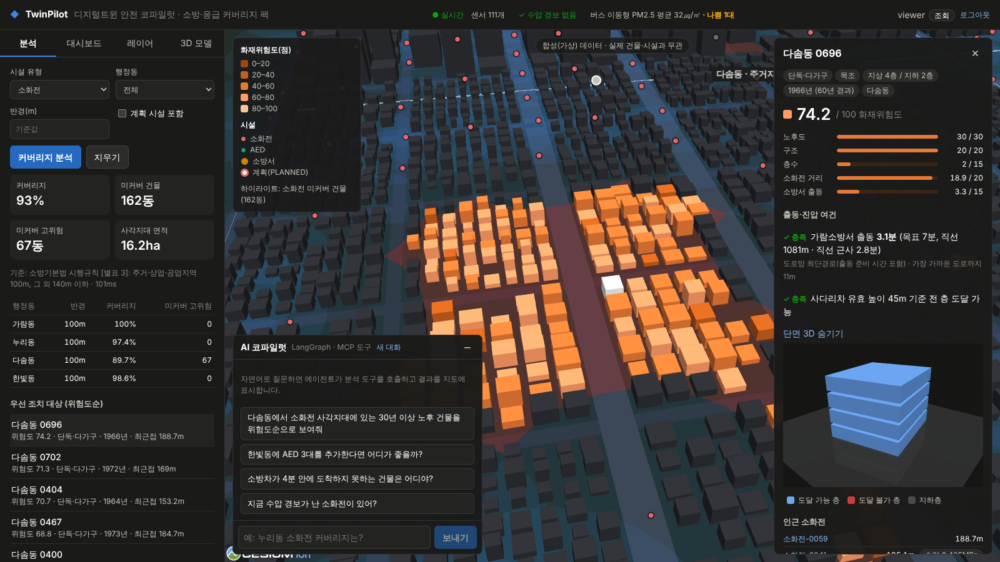
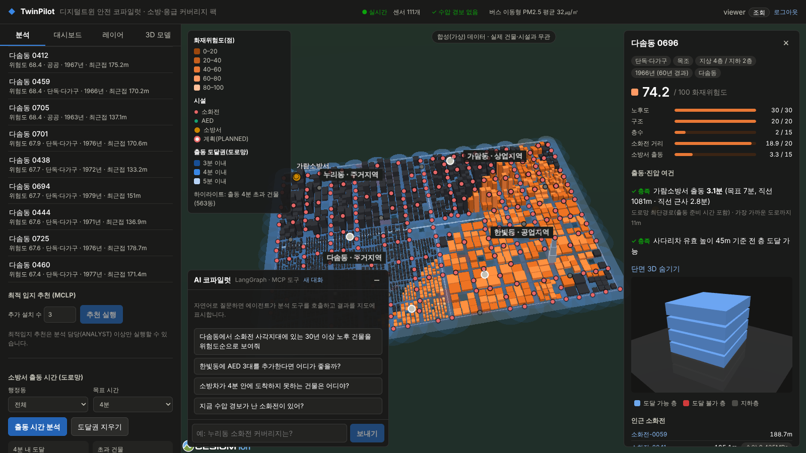
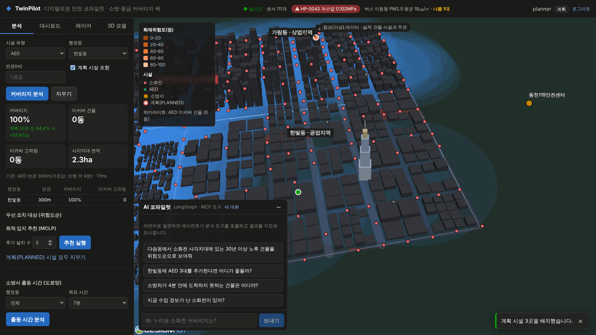
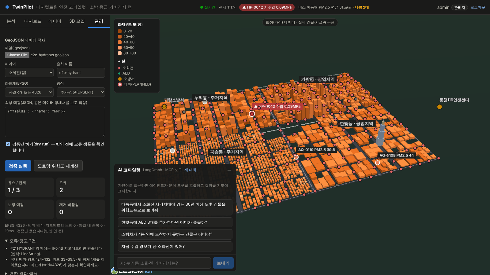
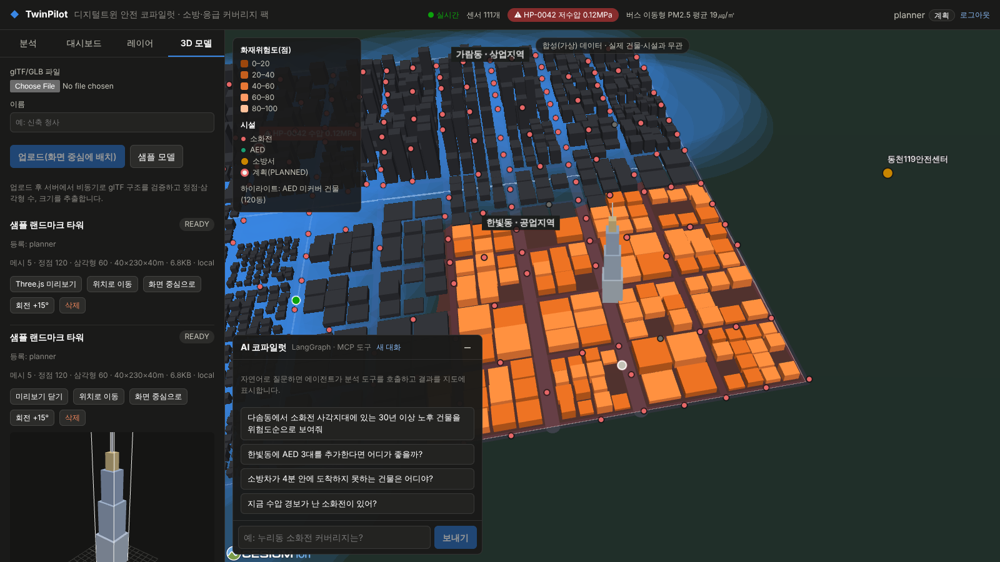

# TwinPilot — 디지털트윈 안전 코파일럿 (v0.2)

> 자연어로 묻고 3D로 답하는 디지털트윈 의사결정 플랫폼.
> 첫 번째 분석 팩은 **소방·응급 안전 커버리지**다. 소화전·AED·소방서 커버리지와 사각지대, 도로망 출동 시간,
> 최적입지, 건물 화재위험도, IoT 센서 모니터링을 다룬다.

⚠️ 데모 데이터는 부산진구 일대 좌표에 생성한 **합성(가상) 도시**다. 실제 건물·시설과 무관하다.



v0.2는 여러 레플리카로 운영하는 것을 전제로 다음을 더했다. 상세 설계는 [아키텍처·운영](docs/03-architecture-ops.md), 근거 수치는 [검증 결과](docs/05-verification.md).

| 영역 | 내용 |
|---|---|
| 인증·권한 | Keycloak(OIDC, PKCE), 역할 VIEWER·ANALYST·PLANNER·ADMIN, 기본 거부 URL 규칙, 서비스 간 토큰 교환(토큰 전달 없음), 감사 로그 |
| 작업 처리 | DB 기반 내구성 작업 큐(SKIP LOCKED·리스·재시도·멱등 키·사용자별 한도), 레플리카 간 SSE(LISTEN/NOTIFY), 리더 선출 |
| 데이터 | GeoJSON 가져오기(매핑·좌표 변환·검증 보고서·UPSERT/REPLACE), 센서 수집 API(일 단위 파티션·보관 기간), 도로망 Dijkstra 출동 시간·도달권 |
| 성능·복원력 | 분석 결과 캐시(동시 요청 합치기, 레플리카 간 무효화), 과부하 시 503 + Retry-After, LLM 장애 시 규칙 기반 전환, graceful shutdown |
| 관측성 | JSON 로그, OpenTelemetry 분산 추적, Prometheus 메트릭·경보 15개, Grafana 대시보드 |
| 운영 | Kubernetes(PSA restricted, NetworkPolicy, HPA·PDB), 일일 백업·복구 Job, kube-prometheus-stack 연동, Argo CD, 런북 |
| 공급망 | 해시 고정 의존성, 비루트·읽기 전용 이미지, CI의 Trivy·pip-audit·npm audit, Dependabot |
| 품질 | 백엔드 41·프론트 13·MCP 12·에이전트 43 테스트, 역할별 E2E 12개(axe·CSP), k6 부하 테스트, 코파일럿 평가 하네스 |

## 구성

| 디렉터리 | 기술 | 역할 |
|---|---|---|
| `backend/` | Java 21, Spring Boot 4, Spring Security(OAuth2 리소스 서버), JdbcClient, Flyway, PostGIS 3.5 | 공간 분석 REST API, 작업 큐, 센서 수집, 데이터 가져오기, 감사 로그 |
| `frontend/` | React 19, TypeScript, CesiumJS(@cesium/engine), Three.js, TanStack Query, oidc-client-ts | 3D 트윈 지도, 분석·대시보드·관리 화면, AI 코파일럿 UI. nginx(CSP·요청 한도·프록시) |
| `mcp-server/` | MCP Python SDK(FastMCP), httpx | 분석 기능을 MCP 도구 9종·리소스 2종·프롬프트 1종으로 노출(OAuth 보호 리소스) |
| `ai-agent/` | LangGraph, LangChain(ChatAnthropic, 기본 `claude-opus-5-5`), langchain-mcp-adapters, FastAPI | MCP 클라이언트 에이전트(SSE 스트리밍, PostgreSQL 체크포인트). 키가 없으면 규칙 기반 플래너 |
| `infra/keycloak/` | Keycloak 26.8 | 최적화 이미지 + realm(역할·클라이언트) |
| `infra/postgis/` | PostgreSQL 16 + PostGIS 3.5(Alpine) | 보안 패치·gosu 제거, 비루트 실행 DB 이미지 |
| `infra/k8s/` | Kustomize | base, components(backup·monitoring), overlays(local·ncp) |
| `infra/argocd/`, `infra/terraform/` | Argo CD, Terraform(ncloud) | GitOps 애플리케이션, NCP(VPC·NKS·Object Storage) IaC |
| `infra/observability/` | OTel Collector, Jaeger, Prometheus, Grafana | 로컬 관측성 스택(compose 프로필) |
| `loadtest/`, `e2e/`, `ai-agent/evals/` | k6, Playwright·axe, Python | 부하 테스트, 브라우저 E2E, 코파일럿 평가 |
| `data/` | Python | 합성 도시 생성기(seed 고정), 샘플 GLB |



## 빠른 시작 (Docker Compose)

```bash
docker compose -f infra/docker-compose.yml up -d --build --wait
open http://localhost:8088          # 데모 계정 viewer / analyst / planner / admin, 비밀번호 twinpilot-demo
```

- 관측성까지: `docker compose -f infra/docker-compose.yml --env-file infra/observability.env --profile observability up -d --wait`
  → Grafana http://localhost:3000, Jaeger http://localhost:16686, Prometheus http://localhost:9090
- LLM 모드: 셸에 `ANTHROPIC_API_KEY`를 두면 에이전트가 `claude-opus-5-5`로 동작한다. 키가 없으면 같은 그래프·MCP 경로를 쓰는 규칙 기반 플래너가 응답한다.
- compose의 비밀번호·시크릿 기본값(`*-local-only`)은 로컬 전용이다. 운영 값은 Kubernetes Secret으로만 주입한다.
- TLS 검사 프록시 뒤에서 빌드할 때: `docker build --secret id=extra_ca,src=ca.pem …`. Alpine 패키지 저장소에 닿지 않으면 `--build-arg APK_UPGRADE=false`.
- v0.1에서 올리는 경우 DB 이미지(사용자 uid·C 라이브러리)가 바뀌었으므로 로컬 볼륨을 새로 만든다: `docker compose … down && docker volume rm twinpilot_pgdata`.

## 로컬 개발

compose로 PostGIS·Keycloak을 띄우고 고치는 서비스만 로컬에서 실행한다. 토큰 `iss`는 `http://localhost:8088/auth/realms/twinpilot`이므로
compose의 frontend(8088)도 함께 띄운다. Keycloak 서명키는 8180 포트로 받는다(기본값).

```bash
docker compose -f infra/docker-compose.yml up -d --wait postgis keycloak frontend
# twin-api → :8080 (Swagger UI /swagger-ui.html)
cd backend && DB_PASSWORD=twin-local-only mvn spring-boot:run
# 프론트엔드 → :5173 (/api·/agent는 Vite 프록시, 로그인은 8088의 Keycloak)
cd frontend && npm ci && npm run dev
```

인증 없이 빠르게 확인할 때는 `SECURITY_MODE=disabled`(twin-api), `MCP_AUTH_MODE=disabled`(mcp-server), `AUTH_MODE=disabled`(ai-agent)를 쓴다.
모든 요청이 ADMIN 개발자로 처리되므로 운영에서는 쓰지 않는다. Claude Desktop 등 외부 MCP 클라이언트는 `python -m twinpilot_mcp --transport stdio`로 연결한다.

## 테스트

| 대상 | 명령 | 결과(2026-10-09) |
|---|---|---|
| backend | `mvn test` (Testcontainers) | 41 통과 |
| frontend | `npm run typecheck && npm test && npm audit` | 13 통과, 취약점 0 |
| mcp-server·ai-agent | `pip install --require-hashes -r requirements.lock && pytest` | 12 / 43 통과 |
| E2E | `cd e2e && npm ci && node suite.mjs` | 역할별 12개 통과, 콘솔·CSP·axe 위반 0 |
| 부하 | `loadtest/run-local.sh api-mixed.js` | 초당 200건 오류 0, p95 20ms(단일 호스트) |
| 코파일럿 평가 | `python ai-agent/evals/run_eval.py` | 규칙 기반 12/12(LLM 전용 3건은 키 필요) |
| 매니페스트 | kubeconform, kube-apiserver dry-run, promtool | 통과(PSA restricted) |

## 배포·운영

- NCP 배포: [docs/runbooks/ncp-deploy.md](docs/runbooks/ncp-deploy.md)
- 백업·복구: [docs/runbooks/backup-restore.md](docs/runbooks/backup-restore.md)
- 경보 대응: [docs/runbooks/alerts.md](docs/runbooks/alerts.md)
- 비밀 교체: [docs/runbooks/secrets-rotation.md](docs/runbooks/secrets-rotation.md)
- 실제 데이터 적재: [docs/runbooks/data-import.md](docs/runbooks/data-import.md)

## 문서

2. [서비스 기획](docs/02-service-plan.md)
3. [아키텍처·운영](docs/03-architecture-ops.md): 인증·토큰 흐름, 작업 큐, 데이터 파이프라인, 성능·장애 대응, 보안, Kubernetes
4. [API](docs/04-api.md): REST(역할별), MCP 도구, 에이전트 SSE, 지도 액션
5. [검증 결과](docs/05-verification.md): 테스트·E2E·부하·복원력·백업·보안 스캔, 검증하지 못한 항목

## 화면

| 커버리지·사각지대 | 건물 상세(위험 요인·Three.js 단면) |
|---|---|
|  |  |
| **도로망 출동 시간·도달권** | **계획 시설 배치 후 재분석** |
|  |  |
| **데이터 가져오기 검증 보고서(관리자)** | **glTF 업로드·검증·미리보기** |
|  |  |

## 데이터·라이선스 고지

- 합성 데이터는 `data/generate_synthetic_city.py`가 만든다. 실제 공공데이터는 같은 스키마로 가져오기 파이프라인에 적재한다.
- OSM 배경지도(선택)는 © OpenStreetMap contributors. 기본 배경은 Cesium 내장 NaturalEarthII다.
- 소화전 반경(100m/140m)은 소방기본법 시행규칙 [별표 3]을 따른다. AED 반경, 도로 속도, 출동 준비 시간, 사다리차 높이는 **가정값**이며 설정으로 바꿀 수 있다.
