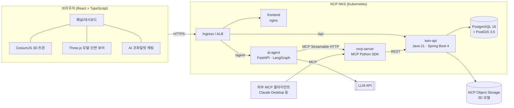
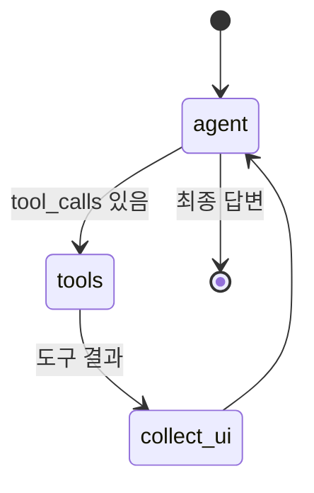

# 02. 신규 플랫폼 서비스 기획 — TwinPilot

> **자연어로 묻고 3D로 답하는 디지털트윈 의사결정 코파일럿**
> 첫 번째 분석 팩: **소방·응급 안전 커버리지 (Safety Coverage Pack)**

---

## 1. 배경과 문제 정의

공개된 지자체 디지털트윈 사업 사례를 정리하면 다음과 같다.

- 지자체 디지털트윈 사업은 공간 DB 구축, 3D 시각화, 분석, 의사결정 지원 순서로 진행된다. 사업마다 화면과 분석을 새로 만드는 일이 반복된다. 예: 대전 실외소화전 DB·시각화, 부산 응급시설 사각지대·최적입지.
- 담당 공무원이 분석을 요청하면 GIS 전문 인력이 쿼리와 화면을 만들어야 결과가 나온다. 질문 하나에 답을 얻기까지 며칠이 걸린다.
- 다음 단계로는 AI 기반 도시 데이터 분석·예측·의사결정 지원이 과제로 꼽힌다.

**문제**: "소화전 100m 사각지대에 있는 30년 이상 노후 건물은 몇 동이고, 소화전 3개를 더 설치한다면 어디가 가장 효과적인가?" 같은 질문에 지금은 즉시 답할 수 없다.

## 2. 서비스 개요

| 항목 | 내용 |
|---|---|
| 서비스명 | TwinPilot |
| 한 줄 정의 | 공간정보(PostGIS)와 3D 트윈(Cesium/Three.js) 위에서 AI 에이전트가 표준화된 분석 도구(MCP)를 호출해 근거가 있는 답과 3D 시각화를 함께 돌려주는 플랫폼 |
| 차별점 | ① 분석을 **MCP 도구**로 표준화한다. 같은 도구를 웹 UI, AI 에이전트, 외부 AI 클라이언트(Claude Desktop 등)가 함께 쓴다. ② 답변마다 **지도 액션**(하이라이트, 이동, 레이어)이 따라와 근거를 3D로 확인할 수 있다. ③ 분석을 **팩(Pack)** 단위로 재사용한다. |
| 첫 번째 팩 | 소방·응급 안전 커버리지. 소화전·AED·소방서 커버리지, 사각지대, 최적입지, 건물 화재위험도, 시설 IoT 모니터링을 다룬다. |
| 타깃 | 지자체 안전·소방 담당 부서, 소방서, 디지털트윈 구축 사업자(플랫폼 운영자) |

## 3. 페르소나와 핵심 시나리오

| 페르소나 | 상황 | TwinPilot에서 하는 일 |
|---|---|---|
| A. 구청 안전총괄과 주무관 | 내년 소화전 추가 설치 예산을 편성해야 한다 | "○○동 소화전 사각지대 노후 건물 보여줘" → 사각지대 폴리곤과 대상 건물이 3D로 하이라이트된다 → "3개 추가하면 어디?" → 추천 지점과 개선 효과(커버리지 %p)를 확인한다 |
| B. 소방서 현장 지휘관 | 고층 건물 화재 출동 | 건물을 클릭하면 층수, 사다리차 도달 불가 층(Three.js 단면 뷰), 인근 소화전 거리와 실시간 수압, 소방서 도달 추정 시간을 본다 |
| C. 플랫폼 운영자/개발자 | 새 지자체에 서비스를 적용 | GeoJSON/SQL로 데이터를 적재하고, glTF 랜드마크 모델을 업로드해 배치한다. Kubernetes(NCP NKS)에 배포한다 |
| D. 외부 AI 사용자 | Claude Desktop 등에서 도시 데이터를 질의 | TwinPilot MCP 서버에 연결해 같은 분석 도구를 호출한다 |

## 4. 기능 명세

### 4.1 MVP (P0) — 이번에 구현한 범위

| ID | 기능 | 설명 | 주요 기술 |
|---|---|---|---|
| F1 | 3D 트윈 뷰 | 건물 압출(높이), 행정동 경계, 도로, 소방시설 레이어. 색상 모드(위험도/용도/노후도). 클릭하면 상세 정보 | Cesium Primitive 배치 렌더링, 피킹 |
| F2 | 커버리지 분석 | 시설 유형과 반경을 넣으면 커버리지율, 미커버 건물, 사각지대 폴리곤을 행정동별로 계산 | PostGIS `ST_DWithin`, `ST_Union`, `ST_Difference`, EPSG:5186 |
| F3 | 최적입지 추천 | 위험도 가중 최대 커버리지 입지(MCLP)를 탐욕(greedy) 알고리즘으로 계산. 추가 전/후 효과를 비교. **비동기 Job + SSE 진행률** | PostGIS 후보 격자, Java 비동기, SSE |
| F4 | 건물 화재위험도 | 노후도·구조·층수·소화전 거리·소방서 도달시간으로 0~100점 산출. 요인별 기여도를 보여줘 설명 가능 | SQL 함수, 공간 조인 |
| F5 | IoT 실시간 모니터링 | 소화전 수압 센서와 버스 이동형 공기질 센서(부산 사례 모델) 스트림. 저수압 경보 | SSE 스트리밍, 시뮬레이터 |
| F6 | AI 코파일럿 | 자연어 질의 → LangGraph 에이전트 → MCP 도구 호출 → 답변 + 지도 액션 + 도구 호출 트레이스 | LangGraph, LangChain, MCP Client, LLM API |
| F7 | 3D 모델 처리 | glTF/GLB 업로드 → 비동기 검증·메타데이터 추출(메시, 정점 수, 바운딩 박스) → 위치 지정 → Cesium 배치, Three.js 뷰어 | Java GLB 파서, Three.js GLTFLoader |
| F8 | 건물 단면 뷰 | 선택한 건물의 층별 3D 단면에 사다리차 유효 높이를 넘는 층을 표시 | Three.js |
| F9 | 분석 대시보드 | KPI, 행정동별 위험도 분포, 준공연도 분포 | SQL 집계, 차트 |
| F10 | MCP 서버 공개 | Streamable HTTP와 stdio 두 가지 전송 방식. 도구 8종, 리소스 2종, 프롬프트 1종 | MCP Python SDK |

### 4.2 로드맵

| 단계 | 기능 |
|---|---|
| P1 (3개월) | 3D Tiles 변환 파이프라인(대용량 건물 → 3D Tiles 1.1), pgRouting 실도로망 도달시간, 분석 시나리오 저장·비교, PDF 리포트, RBAC·멀티테넌시, 공공데이터 커넥터(건축물대장 표제부, 소방용수시설) |
| P2 (6개월) | 생활환경 스트레스 팩(소음·빛·공기질, CFD 결과 연동), 홍수·산사태 팩, 시민 포털(내 주변 AED), 다국어(영어·아랍어) |
| P3 | 예측 모델(센서 시계열 이상탐지·수요 예측), 에이전트 평가 파이프라인 고도화, 온프레미스·공공 클라우드(CSAP) 패키지 |

## 5. 분석 로직 상세

### 5.1 기준값 (설정으로 변경 가능)

| 항목 | 기본값 | 근거 |
|---|---|---|
| 소화전 커버 반경 | 주거·상업·공업지역 100m, 그 외 140m | 소방기본법 시행규칙 [별표 3] 소방용수시설 설치기준(수평거리) |
| AED 커버 반경 | 300m | **가정값**. 보행 약 4분 도달을 기준으로 둔 데모 설정 |
| 소방서 도달 목표 | 7분 | 화재 골든타임으로 통용되는 기준 |
| 도달시간 추정 | 직선거리 × 우회계수 1.3 ÷ 30km/h | **MVP 근사**. P1에서 pgRouting으로 대체 |
| 사다리차 유효 높이 | 45m | **가정값**. 장비별로 다르므로 설정값으로 둔다 |

### 5.2 화재위험도 점수 (0~100)

```
risk = 30 × age_factor         (준공 후 경과연수 / 50, 최대 1)
     + 20 × structure_factor   (목조 1.0, 조적 0.8, 철골 0.5, 철근콘크리트 0.3)
     + 15 × height_factor      (층수 / 30, 최대 1)
     + 20 × hydrant_factor     (최근접 소화전 거리 / 200m, 최대 1)
     + 15 × response_factor    (소방서 도달 추정시간 / 14분, 최대 1)
```

요인별 기여도를 응답에 함께 넣어 "왜 위험한가"를 설명할 수 있게 한다.

### 5.3 최적입지 추천 (MCLP, 탐욕 알고리즘)

1. 분석 영역의 도로 중심선을 따라 후보 지점을 만든다(기본 25m 간격, 소화전은 도로변에 설치).
2. 각 후보에 대해 "반경 안의 **미커버** 건물 위험도 합"을 계산한다.
3. 가장 큰 후보를 선택하고, 그 후보가 커버하는 건물을 커버 처리한다. 2~3을 k번 반복한다.
4. 전/후 커버리지율, 새로 커버되는 건물 수와 위험도 합을 반환한다.

탐욕 MCLP는 (1−1/e) 근사 보장이 있다. 수 초 안에 끝나는 크기라 MVP에 맞다.

## 6. 시스템 아키텍처



**설계 원칙**
- **단일 진실 원천**: 모든 공간 분석은 `twin-api`(Java)의 REST API에 있다. 웹 UI, MCP 서버, 에이전트는 같은 API를 쓰므로 결과가 일치한다.
- **AI는 읽기 전용 도구만 쓴다**: 임의 SQL을 실행하는 도구는 두지 않는다. 파라미터를 검증하는 분석 도구만 노출해 SQL 인젝션을 막고 결과를 재현할 수 있게 한다.
- **LLM 없이도 동작**: API 키가 없으면 규칙 기반 플래너가 같은 LangGraph 그래프와 MCP 도구 경로를 탄다. 오프라인 데모와 테스트에 쓴다.

## 7. 데이터 모델 (PostGIS)

| 테이블 | 주요 컬럼 | 비고 |
|---|---|---|
| `region` | id, code, name, zone_type, geom(MultiPolygon,4326) | 행정동. `zone_type`(주거·상업·공업·녹지)으로 소화전 기준 반경을 정한다 |
| `building` | id, name, use_type, structure, floors, height_m, built_year, region_id, geom(MultiPolygon,4326), risk_score, risk_factors(jsonb) | 건축물대장 표제부 필드(주용도·구조·지상층수·높이·사용승인일)에 대응 |
| `facility` | id, type(HYDRANT/AED/FIRE_STATION), subtype, name, status, installed_year, geom(Point,4326) | 소방용수시설(지상식·지하식·급수탑) 필드에 대응 |
| `road` | id, name, width_m, geom(LineString,4326) | 후보 격자 필터링에 쓴다 |
| `sensor` | id, kind(HYDRANT_PRESSURE/AIR_QUALITY), facility_id, route_id | |
| `sensor_reading` | sensor_id, ts, value jsonb, geom | 시계열(MVP는 메모리 스트림과 최근값) |
| `model_asset` | id, name, status, storage_key, format, size, stats(jsonb), lon, lat, height, heading | 3D 모델 메타데이터 |
| `analysis_job` | id, type, status, progress, params(jsonb), result(jsonb) | 비동기 Job |

- 인덱스: 모든 `geom`에 GIST 인덱스를 둔다. 미터 단위 연산은 `ST_Transform(geom, 5186)`(Korea 2000 / Central Belt 2010)으로 한다.
- 데이터: MVP는 **합성 데이터**(부산진구 일대 좌표에 생성한 가상 도시)를 쓴다. 실제 건물·시설과는 관계없다. 실제 데이터는 같은 스키마의 GeoJSON으로 적재한다.

## 8. API 개요 (`/api/v1`)

| Method | Path | 설명 |
|---|---|---|
| GET | `/regions` | 행정동 목록과 경계 |
| GET | `/buildings` | bbox·위험도·용도·준공연도 필터. GeoJSON |
| GET | `/buildings/{id}` | 상세. 최근접 소화전·AED·소방서·센서를 **병렬 조회**한다 |
| GET | `/facilities` | 시설 레이어 |
| GET | `/roads` | 도로 레이어 |
| POST | `/analysis/coverage` | 커버리지·사각지대 분석(동기) |
| POST | `/analysis/jobs` | 최적입지 등 무거운 분석 Job 생성(비동기, 202) |
| GET | `/analysis/jobs/{id}` | Job 상태와 결과 |
| GET | `/analysis/jobs/{id}/events` | Job 진행률 SSE |
| GET | `/stats/summary` | 대시보드 집계 |
| GET | `/sensors` · `/sensors/stream` | 센서 최근값 · SSE 실시간 스트림 |
| POST/GET/PUT | `/models`, `/models/{id}`, `/models/{id}/file`, `/models/{id}/placement` | 3D 모델 업로드·메타·파일·배치 |

에이전트 API: `POST /agent/chat`(SSE 스트림: `tool_call`, `tool_result`, `ui_action`, `message`, `done` 이벤트)

## 9. AI 설계

### 9.1 LangGraph 그래프



- `agent`: LLM(도구 바인딩) 또는 규칙 기반 플래너
- `tools`: MCP 도구를 감싼 LangChain Tool. 여러 도구 호출을 동시에 실행한다
- `collect_ui`: 도구 결과의 `ui_actions`(highlight, flyTo, showLayer, drawPolygons, markPoints)를 모아 프론트엔드로 보낸다
- 최대 반복 횟수(6)로 무한 루프를 막는다

### 9.2 MCP 서버

| 종류 | 이름 | 설명 |
|---|---|---|
| Tool | `list_regions` | 행정동 목록·기준 반경 |
| Tool | `search_buildings` | 조건(동, 노후 연수, 위험도, 용도, 층수)으로 건물 검색 |
| Tool | `get_building_detail` | 건물 상세와 주변 시설 |
| Tool | `analyze_coverage` | 시설 커버리지·사각지대 |
| Tool | `recommend_facility_sites` | 최적입지 추천(Job 실행 후 대기) |
| Tool | `get_dashboard_stats` | 집계 통계 |
| Tool | `get_sensor_status` | 센서 최신값·경보 |
| Tool | `list_3d_models` | 배치된 3D 모델 |
| Resource | `twin://schema`, `twin://standards` | 데이터 사전, 분석 기준값 |
| Prompt | `safety_briefing` | 행정동 안전 브리핑 작성 프롬프트 |

### 9.3 품질 관리
- **도구 선택 평가셋**: 질의와 기대 도구·인자 쌍(`ai-agent/tests`)으로 플래너의 도구 선택을 회귀 테스트한다.
- **근거 표기**: 답변 수치는 도구 결과에서만 인용한다(시스템 프롬프트로 강제). 합성 데이터라는 사실도 함께 알린다.

## 10. 비동기·성능 설계

| 계층 | 기법 |
|---|---|
| Java API | Java 21 **가상 스레드**(`spring.threads.virtual.enabled`), 건물 상세의 `CompletableFuture` 병렬 조회, 무거운 분석은 **Job + SSE 진행률**, GZIP 압축, 정적 레이어 캐시(ETag/Cache-Control) |
| PostGIS | GIST 인덱스, `ST_DWithin`으로 인덱스를 타는 근접 질의, 5186 투영 미터 연산, 커버리지 결합은 `ST_Union`을 한 번만 수행 |
| 프론트엔드 | React Query 캐시·중복 제거, 요청 취소(AbortController), Cesium **Primitive 배치**(건물 수천 동을 한 번에 그림), Three.js 뷰어 코드 분할(lazy) |
| AI | SSE 이벤트 스트리밍, 동시 도구 실행, MCP 세션 재사용, 도구 결과 크기 제한(요약 + ID 목록) |

## 11. 인프라 — NCP + Kubernetes

| 구성요소 | NCP 서비스 | 비고 |
|---|---|---|
| 컨테이너 오케스트레이션 | Ncloud Kubernetes Service(NKS) | VPC, 노드용 private subnet, LB 전용 subnet |
| 이미지 레지스트리 | Container Registry(NCR) | `imagePullSecrets` |
| 3D 모델 저장 | Object Storage(S3 호환) | 백엔드 `storage.type=s3`, endpoint `https://kr.object.ncloudstorage.com` |
| 인그레스 | ALB Ingress Controller | `ingressClassName: alb` |
| DB | PostGIS StatefulSet(블록 스토리지 PVC). 운영 전환 시 관리형 DB의 PostGIS 지원 여부를 확인한다 | |
| 관측 | Prometheus 스크레이프(Actuator `/actuator/prometheus`), Cloud Log Analytics | |

- 매니페스트: `infra/k8s/base` + `overlays/local`, `overlays/ncp` (Kustomize)
- 확장: HPA(twin-api, ai-agent), PDB, NetworkPolicy(DB는 twin-api에서만 접근), readiness/liveness 프로브
- IaC: `infra/terraform/ncp`(VPC, 서브넷, NKS 클러스터·노드풀)

## 12. 성공 지표 (MVP 검증용)

| 지표 | 목표 |
|---|---|
| 질의부터 3D 근거 표시까지 시간 | 10초 이내(LLM 응답 시간 포함) |
| 커버리지 분석 API p95 | 1초 이내(건물 5천 동 기준) |
| 최적입지 Job | 10초 이내 완료, 진행률 실시간 표시 |
| 도구 선택 정확도(평가셋) | 90% 이상 |

## 13. 리스크와 대응

| 리스크 | 대응 |
|---|---|
| LLM 환각 수치 | 도구 결과만 인용, 결과 ID로 지도 하이라이트, 규칙 기반 폴백 |
| 대용량 3D 데이터 | P1에서 3D Tiles 변환, LOD, 타일 스트리밍 |
| 직선거리 근사 오차 | P1에서 pgRouting 실도로망 적용, 근사임을 UI에 표기 |
| 공공 클라우드 요건 | NCP 공공존·CSAP 대응, 온프레미스 Kustomize overlay |
