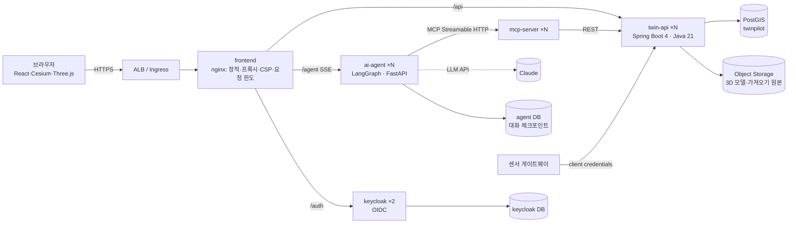
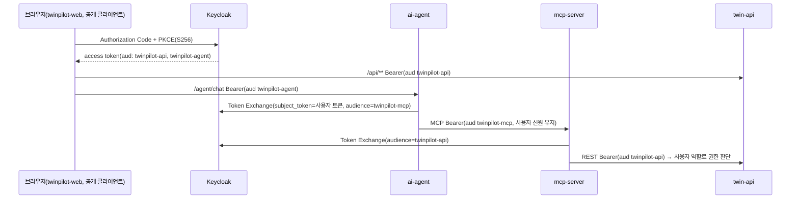

# 03. 아키텍처·운영 (v0.2)

v0.1(MVP)은 인증 없이 한 인스턴스에서 동작하는 데모였다. v0.2는 여러 레플리카로 운영하는 것을 전제로
인증·권한, 내구성 있는 작업 큐, 데이터 적재, 관측성, 장애 대응, 배포·백업 자동화를 더했다.

## 1. 구성 요소



| 서비스 | 상태 | 레플리카 간 공유 방식 |
|---|---|---|
| frontend | 없음 | — |
| twin-api | 없음(모두 DB) | 작업 큐·리스(DB), SSE 팬아웃(LISTEN/NOTIFY), 리더 선출(테이블 리스), 캐시 무효화(NOTIFY) |
| mcp-server | 없음 | Streamable HTTP(stateless) |
| ai-agent | 대화 기록 | PostgreSQL 체크포인터(agent DB) |
| keycloak | 세션 | Infinispan 클러스터(jdbc-ping 탐색, 노드 간 mTLS) + 영속 세션(DB) |
| postgis | 데이터 | StatefulSet 1개 + 일일 백업(관리형 DB 전환 검토) |

PostgreSQL 인스턴스 하나에 데이터베이스 3개(twinpilot·keycloak·agent)를 두고 사용자를 분리한다.
`infra/k8s/base/postgis/init-databases.sql`이 사용자·DB를 멱등하게 만들고 비밀번호를 Secret 값으로 맞춘다
(compose는 최초 기동 시, Kubernetes는 배포마다 `postgres-bootstrap` Job으로 실행).

## 2. 인증·권한

### 2.1 역할

| 역할 | 할 수 있는 일(상위 역할은 하위 권한 포함) |
|---|---|
| VIEWER | 지도·검색·상세·통계·센서 조회, 커버리지·출동 시간 분석, 코파일럿 |
| ANALYST | + 분석 Job(최적입지 추천·위험도 재계산) 실행·취소 |
| PLANNER | + 계획(PLANNED) 시설 배치·삭제, 3D 모델 업로드·배치·삭제 |
| ADMIN | + 데이터 가져오기, 감사 로그, 전체 Job 조회 |
| INGEST | 센서 측정값 수집 API만(게이트웨이 서비스 계정) |

Keycloak realm(`infra/keycloak/twinpilot-realm.json`)에 복합 역할로 정의하고, twin-api는
`RoleHierarchyImpl`로 같은 위계를 적용한다. URL 규칙은 **기본 거부(deny by default)**다
(`SecurityConfig`: 명시하지 않은 경로는 `denyAll`). 401·403은 RFC 9457 ProblemDetail로 응답한다.
프론트엔드는 역할에 따라 버튼을 숨기거나 끄지만, 최종 판단은 서버가 한다.

### 2.2 토큰 흐름(토큰 전달 없이 교환)



- 각 서비스는 자기 audience가 든 토큰만 받는다. 받은 토큰을 그대로 다음 서비스로 넘기지 않고(no token passthrough)
  Keycloak 표준 토큰 교환(RFC 8693)으로 대상 audience 토큰을 받는다. 그래서 VIEWER가 코파일럿으로 추천을 요청해도
  twin-api가 403을 돌려주고, 에이전트는 권한이 없다고 답한다(평가 사례 `rbac-viewer-recommend`).
- 토큰 `iss`는 브라우저가 보는 공개 주소(`KC_HOSTNAME`)이고, 서명키(JWKS)·토큰 교환은 클러스터 내부 주소로 받는다
  (`KC_HOSTNAME_BACKCHANNEL_DYNAMIC`). twin-api는 `issuer-uri`(공개)와 `jwk-set-uri`(내부)를 따로 둔다.
- 웹 토큰은 sessionStorage에 두고 만료 60초 전에 refresh token으로 갱신한다. realm은 refresh token 회전과
  재사용 감지를 켠다(같은 refresh token을 두 번 쓰면 해당 클라이언트 세션을 끊는다). 탭마다 별도 토큰 체인이므로
  여러 탭에서도 충돌하지 않는다(같은 SSO 세션의 두 탭이 각자 갱신하는 경우를 확인했다).
- 무차별 대입 방어: 실패 5회부터 잠금(대기 60초씩 증가, 최대 15분). 같은 계정으로 짧은 시간에 수십 번 로그인해도
  잠길 수 있으므로 부하 테스트는 VU마다 비밀번호 로그인을 하지 않는다(`loadtest/lib/auth.js`).
- 서비스 계정: `twinpilot-sensor-gateway`(INGEST), `twinpilot-mcp`·`twinpilot-agent`(토큰 교환용 기밀 클라이언트).

### 2.3 감사 로그

데이터 가져오기, 계획 시설 배치·삭제·일괄 삭제, 3D 모델 업로드·배치·삭제, Job 제출·취소를 `audit_log`에 남긴다
(행위자 subject·사용자명, 대상, 세부 JSON, 클라이언트 IP, trace ID, 시각). ADMIN만 `/api/v1/admin/audit`로 조회한다.

- DB 변경과 감사 기록은 한 트랜잭션으로 쓴다. 감사 기록이 실패하면 변경도 롤백되므로 "변경은 됐는데 기록이 없는" 상태가 생기지 않는다.
- 파일 저장소가 끼어 트랜잭션으로 묶을 수 없는 모델 업로드·삭제는 기록이 실패해도 작업을 막지 않고, 감사 내용 전체를 구조화 로그로
  남긴 뒤 실패 수(`twinpilot_audit_write_failures_total`)를 센다(경보 `AuditWriteFailures`).
- 부하 시험에서 커넥션 풀이 고갈됐을 때 감사 기록만 빠지는 경우를 발견해 이 구조로 바꿨다(05 문서 §5).

## 3. 비동기 처리와 다중 레플리카

### 3.1 내구성 있는 작업 큐(`analysis_job`)

- 상태: `QUEUED → RUNNING → SUCCEEDED | FAILED | CANCELLED`. 작업 유형: 최적입지 추천, 위험도 재계산, 데이터 가져오기,
  3D 모델 검증.
- 가져가기: `SELECT … FOR UPDATE SKIP LOCKED`로 레플리카마다 겹치지 않게 가져가고 리스(60초)를 잡는다.
  실행 중에는 하트비트로 리스를 연장하고, 리스가 끝난 작업은 리퍼가 다시 대기열에 넣는다(최대 3회, 지수 백오프).
- 펜싱: 상태 변경은 `locked_by = 내 워커 ID` 조건으로만 한다. 리스를 잃은 워커가 늦게 끝나도 결과를 덮어쓰지 않는다.
- `Idempotency-Key` 헤더로 같은 요청의 재전송을 한 작업으로 묶고, 사용자별 동시 작업 수(기본 5)를 넘으면 429를 돌려준다.
- 쿼리 시간 초과(`QueryTimeoutException`)는 다시 해도 같은 결과이므로 재시도하지 않고 바로 실패 처리한다.
- 종료할 때(graceful shutdown) 실행 중인 작업이 유예 시간 안에 끝나지 않으면 대기열로 돌려놓아 다른 레플리카가 이어받는다.

### 3.2 레플리카 간 이벤트

| 채널(PostgreSQL NOTIFY) | 용도 |
|---|---|
| Job 진행·완료 | 어느 레플리카에 연결한 SSE 구독자에게도 진행률을 보낸다 |
| Job 대기열 | 새 작업이 들어오면 워커를 바로 깨운다(폴링 5초는 보조) |
| 센서 수집 | 측정값을 받은 레플리카와 관계없이 모든 레플리카의 센서 SSE가 같은 상태를 보낸다 |
| `twinpilot_data_changed` | 건물·시설·위험도가 바뀌면 모든 레플리카의 분석 캐시를 비운다 |

알림 연결이 끊겼다 다시 붙으면 놓친 알림이 있을 수 있으므로 캐시를 비우고 상태를 다시 읽는다.

### 3.3 리더 선출

센서 시뮬레이터, 오래된 센서 파티션 정리, 스테이징 정리처럼 클러스터에서 한 번만 돌아야 하는 작업은
`leader_lease` 테이블 리스로 리더를 정한다. 리더가 죽으면 리스 만료 후 다른 레플리카가 이어받는다.

## 4. 데이터

### 4.1 센서 수집

`POST /api/v1/sensors/readings`(INGEST, 한 번에 최대 1,000건). 측정값은 일 단위 RANGE 파티션 테이블
`sensor_reading`에 쌓고 최신값은 `sensor_latest`에 upsert한다. 파티션은 미리 만들고, 기본 파티션에 들어간
행은 새 파티션으로 옮긴다. 보관 기간(기본 7일)이 지난 파티션은 통째로 지운다.

### 4.2 도로망 출동 시간

도로 중심선을 `ST_Node`로 교차점에서 나눠 그래프(노드 143·간선 243, 합성 데이터)를 만들고, Java에서 CSR 형태로
메모리에 올려 소방서 전체를 출발점으로 하는 다중 출발점 Dijkstra를 돌린다. 도로 폭별 속도(40·30·20km/h)와
출동 준비 60초는 가정값이다. 건물별 출동 시간(`response_s`)은 위험도 계산에 쓰고, 도달권(isochrone)은
`ST_LineSubstring` + buffer로 만든다.

### 4.3 GeoJSON 가져오기

```
업로드(최대 200MB) → 저장소 → Job(IMPORT)
  → 스트리밍 파싱(Jackson 3, 피처 단위) → 스테이징(배치 500)
  → ANALYZE → 범위 밖 제거 → ST_Transform·ST_MakeValid·ST_CollectionExtract → 빈 도형 제거
  → 같은 external_id 중복 제거(창 함수) → 병합(UPSERT / REPLACE)
  → (선택) 출동 시간·위험도 재계산 → 감사 로그·캐시 무효화
```

- 대상 레이어: BUILDING, HYDRANT, AED, FIRE_STATION, ROAD, REGION. 속성 매핑 JSON으로 원본 필드를 표준 필드에 연결한다.
- `dryRun=true`면 검증 보고서(유효·무효·범위 밖·보정·중복 건수, 오류 예시)만 만든다.
- 출처(`source`)별로 관리하므로 REPLACE는 같은 출처의 기존 행만 바꾼다.
- 병합은 한 트랜잭션에서 `SET LOCAL statement_timeout = '30min'`으로 실행한다(요청 처리 쿼리는 30초 제한).
- 비정상 종료로 남은 스테이징 행은 매시간 정리한다(6시간 경과).
- 15만 피처를 7.2초에 검증했다. 처리 중 워커를 강제 종료해도 다른 레플리카가 이어받아 끝냈다(05 문서).

## 5. 성능

| 항목 | 적용 | 근거·측정(05 문서) |
|---|---|---|
| 요청 처리 | 가상 스레드, 독립 질의 병렬 실행(건물 상세 4, 통계 8, 검색 2) | 건물 상세 p95 5.8ms(초당 200건 부하 중) |
| 분석 캐시 | 통계·커버리지·출동 시간 결과를 조건별로 재사용(TTL 15·60초, 동시 요청 합치기, 항목 수 상한). 데이터가 바뀌면 NOTIFY로 모든 레플리카에서 비운다 | 초당 200건 단계 부하에서 p95 776ms → 20ms, PostGIS CPU 317% → 72%. 조건이 매번 다르면 초당 60건 부근이 한계(단일 호스트) |
| 과부하 | DB 커넥션 대기 초과는 500이 아니라 503 + `Retry-After` | 캐시 도입 전 통계 엔드포인트가 커넥션 풀을 고갈시켜 500을 냈다 |
| GeoJSON | PostGIS가 직접 생성, gzip, weak ETag(304) | 건물 레이어 913KB → 119KB |
| PostGIS | 5186 생성 컬럼 + GIST, KNN 후 정확 거리, `SET jit = off`, 추천 후보를 도로 분할점으로 | 추천 6.8초 → 0.27초 |
| 커넥션 | twin-api 풀 20, Keycloak 풀 20(기본 100에서 낮춤), PostgreSQL `max_connections=250` | 최대 레플리카 기준 예산: 6×20 + 2×20 + 4×10 + 여유 |
| 프론트엔드 | Cesium Primitive 일괄 렌더링, 벤더 청크 분리(cesium·react·auth), Three.js 지연 로딩 | — |

## 6. 장애 대응 설계

| 상황 | 동작 |
|---|---|
| LLM API 장애(과부하·속도 제한·5xx·연결·시간 초과, 재시도 후) | 그 턴을 규칙 기반 플래너로 이어서 답하고 `notice`로 알린다. 체크포인트에서 이어가므로 대화 기록이 깨지지 않는다 |
| MCP·twin-api 오류 | 도구 오류로 LLM에 돌려주고, 사용자에게는 실패한 도구를 표시한다 |
| 워커 비정상 종료 | 리스 만료 후 다른 레플리카가 재시도(최대 3회) |
| 레플리카 종료(배포) | readiness 해제 → preStop 5초 → graceful shutdown(진행 중 요청 완료, Job 반납) |
| DB 과부하 | 503 + Retry-After, 요청 쿼리 30초 제한 |
| 요청 폭주 | nginx IP당 한도(API 30r/s·burst 60, 에이전트 2r/s), 에이전트 사용자당 분당 20회(burst 5), Job 사용자당 동시 5개 |
| SSE 끊김 | 프론트엔드가 지수 백오프로 재연결하고 토큰을 갱신한다 |
| 알림 연결 끊김 | 재연결 후 캐시 무효화·상태 재조회 |

## 7. 관측성

- **로그**: 모든 서비스가 stdout JSON(twin-api ECS 형식, Python JSON, nginx JSON 접근 로그, Keycloak JSON). 요청에 trace ID가 붙는다.
- **추적**: OpenTelemetry(OTLP). 코파일럿 질의 하나가 ai-agent → mcp-server → twin-api를 거치는 하나의 트레이스(46 span)로 이어진다.
- **메트릭**: twin-api `/actuator/prometheus`(관리 포트 8081, 외부 비노출), mcp-server·ai-agent `/metrics`, Keycloak `/auth/metrics`(9000).
  업무 메트릭: Job 대기·완료·실패, 센서 수집 수락·거절, 에이전트 대화 결과·LLM 토큰·fallback, MCP 도구 호출 결과.
- **경보**(`infra/observability/alerts.yml` 10개 + Kubernetes 전용 5개): 5xx 비율, p95 지연, Job 적체·실패, 센서 수집 중단,
  LLM fallback 증가, 에이전트·MCP 오류, DB 커넥션 대기, 감사 기록 실패, 대상 다운, 재시작 반복, 백업 누락·실패, DB 볼륨 여유 부족.
  대응 절차는 [runbooks/alerts.md](runbooks/alerts.md).
- **대시보드**: Grafana `TwinPilot 운영 개요`(14 패널). compose는 `--profile observability`, Kubernetes는 kube-prometheus-stack 사이드카가 읽는다.

## 8. 보안

| 영역 | 적용 |
|---|---|
| 인증·권한 | §2. 기본 거부 URL 규칙, audience 검증, 토큰 교환, 역할별 UI |
| 웹 | 엄격한 CSP(`script-src 'self' 'wasm-unsafe-eval'`: 인라인 스크립트·JS eval 금지. Knockout eval을 쓰는 Cesium Viewer 대신 CesiumWidget), HSTS(HTTPS일 때), `X-Content-Type-Options`, `Referrer-Policy`, `Permissions-Policy`, `Cross-Origin-Opener-Policy`, `frame-ancestors 'none'`. Keycloak 로그인 화면은 별도 CSP |
| 입력 | SQL 바인딩 파라미터만, 정렬·유형 허용 목록, glTF 구조 검증, 업로드 크기 제한, GeoJSON 좌표 범위·도형 검증 |
| AI | MCP 도구는 모두 읽기 전용(쓰기는 사용자 권한으로 twin-api가 판단), 도구 인자 스키마 검증, 도구 호출 한도, 시스템 프롬프트 비공개(평가 사례) |
| 컨테이너 | 비루트, 읽기 전용 루트 파일시스템(Keycloak 최적화 이미지·PostGIS 포함), `drop ALL`, 권한 상승 금지, seccomp RuntimeDefault. 런타임 이미지에서 pip·gosu 등 불필요 바이너리 제거. 수정 가능한 HIGH·CRITICAL: twin-api·mcp-server·ai-agent·keycloak 0, PostGIS·frontend는 남은 항목이 모두 Alpine 패키지라 CI의 `apk upgrade`로 해소(이 환경에서는 저장소 차단으로 미확인) |
| 클러스터 | Pod Security `restricted` 강제(PostGIS 포함 모든 워크로드), 네임스페이스 기본 차단 NetworkPolicy, ServiceAccount 토큰 미마운트 |
| 공급망 | 해시 고정 Python 의존성(`requirements.lock`), npm `package-lock.json`, CI에서 Trivy(이미지)·pip-audit·npm audit |
| 비밀 | Secret으로만 주입. `secrets.env`·`terraform.tfvars`는 버전 관리 제외. 교체 절차는 [runbooks/secrets-rotation.md](runbooks/secrets-rotation.md) |

## 9. Kubernetes 구성

```
infra/k8s/
├── base/                      Namespace(PSA restricted), SA, ConfigMap, NetworkPolicy
│   ├── postgis.yaml           StatefulSet(자체 이미지 infra/postgis: Alpine·gosu 제거, uid 70, 읽기 전용 루트, max_connections 250)
│   ├── postgres-bootstrap.yaml  keycloak·agent DB/사용자 멱등 생성 Job(Argo CD Sync 훅)
│   ├── keycloak.yaml          클러스터링(jdbc-ping·파드 IP 바인드), 읽기 전용 루트, realm 엔드포인트 프로브
│   └── twin-api·mcp-server·ai-agent·frontend.yaml
├── components/
│   ├── backup/                CronJob: pg_dump(3개 DB) → Object Storage, 보관 기간 정리, 복구 Job·스크립트
│   └── monitoring/            ServiceMonitor 4, PrometheusRule(15), Grafana 대시보드 ConfigMap(generate.py로 생성)
└── overlays/
    ├── local/                 kind 등: 로컬 시크릿, 데모 사용자, ai-agent 2개
    └── ncp/                   NKS: NCR 이미지, ALB Ingress(NodePort), nks-block-storage, Object Storage,
                               레플리카 2개, HPA 3, PDB 5, PUBLIC_HOST 한 곳에서 공개 주소 일괄 치환
infra/argocd/                  AppProject(twinpilot·platform), Application(twinpilot, kube-prometheus-stack)
```

| 워크로드 | 프로브 | 확장 |
|---|---|---|
| twin-api | 관리 포트 8081: startup·liveness·readiness | HPA 2~6, Object Storage로 모델 공유 |
| mcp-server | `/healthz` | HPA 2~4 |
| ai-agent | `/agent/health` | HPA 2~4, 대화는 agent DB |
| keycloak | realm `.well-known`(startup·readiness), `/auth/health/live`(9000) | 2개 + PDB, 파드 분산 |
| frontend | `/healthz` | 2개 + PDB |
| postgis | `pg_isready` | 1개 |

Keycloak은 `health/ready`가 realm 가져오기(비동기) 전에 UP을 돌려주므로 realm `.well-known` 응답으로 준비 여부를 본다.
트랜잭션 로그 경로를 쓰지 못하면 복구 모듈 초기화가 모듈마다 10초씩 지연되므로 emptyDir를 붙인다(기동 88초 → 5초).

## 10. 배포·운영 절차

| 절차 | 문서 |
|---|---|
| NCP 배포(Terraform → 이미지 → Secret → Argo CD → 점검) | [runbooks/ncp-deploy.md](runbooks/ncp-deploy.md) |
| 백업·복구 | [runbooks/backup-restore.md](runbooks/backup-restore.md) |
| 경보 대응 | [runbooks/alerts.md](runbooks/alerts.md) |
| 비밀 교체 | [runbooks/secrets-rotation.md](runbooks/secrets-rotation.md) |
| 실제 데이터 적재 | [runbooks/data-import.md](runbooks/data-import.md) |

CI(`.github/workflows/ci.yml`): 서비스별 테스트 → npm audit·pip-audit → 매니페스트 검증(kubeconform + CRD 스키마,
promtool, 모니터링 리소스 동기화 확인) → compose 전체 스택 E2E → 이미지 빌드·Trivy(수정 가능한 HIGH·CRITICAL이면 실패)
→ main·태그에서만 NCR 푸시.

## 11. 알려진 한계

| 한계 | 대응 방향 |
|---|---|
| PostgreSQL이 StatefulSet 1개(단일 장애점). 일일 백업만 있다(RPO 최대 24시간) | 관리형 DB(PostGIS 지원 확인) 또는 CloudNativePG(스트리밍 복제·PITR) |
| 도로망이 일방통행·신호·혼잡을 반영하지 않는다 | 실도로망 데이터(속성 포함) 적재 후 가중치 보정 |
| 건물을 GeoJSON 압출로 렌더링한다(수천 동 규모 적합) | 3D Tiles 1.1 변환 파이프라인 |
| 분석 캐시는 같은 조건의 반복 요청에 효과가 크다. 조건이 매번 다르면 캐시 전 비용(05 문서)이 그대로 든다 | 조건별 사전 계산, 읽기 전용 복제본 |
| 실제 LLM 응답 품질·NCP 실배포는 이 환경에서 검증하지 못했다 | API 키·NCP 계정으로 평가 하네스와 배포 절차 실행 |
