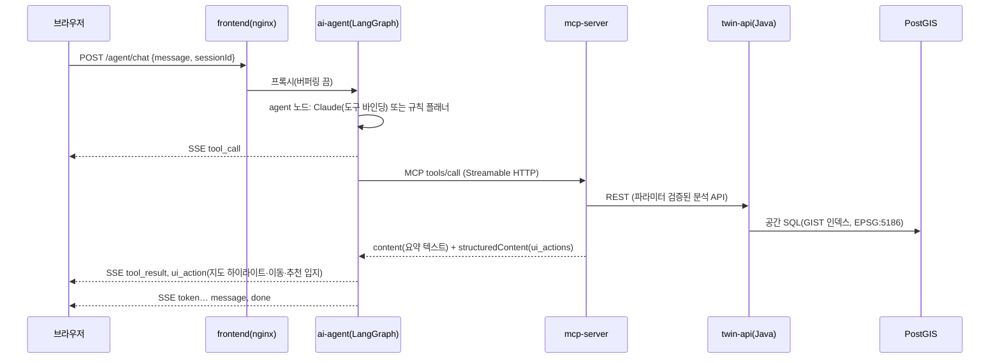

# 03. 아키텍처·운영

## 1. 요청 흐름

### 1.1 AI 코파일럿 질의



- **LLM에는 요약만, 지도에는 전체 결과를 보낸다.** MCP 도구는 `content`에 요약 텍스트와 핵심 수치를 담고 `structuredContent.ui_actions`에 대량 ID 목록과 좌표를 담는다. 에이전트의 `collect_ui` 노드가 액션을 분리해 프론트엔드로 보낸다. 토큰 비용은 줄고, 지도는 결과 전체(예: 119동 하이라이트)를 그린다.
- **대화 기록은 이어 붙이기만 한다(append-only).** LangGraph 체크포인터가 `thread_id(=sessionId)` 단위로 저장한다. 기본은 메모리이고, `CHECKPOINT_DB_URL`을 주면 PostgreSQL에 저장해 레플리카 간에 공유한다.
- **프론트엔드는 에이전트 출력을 신뢰하지 않는다.** `applyUiAction`이 액션 유형·좌표·ID 형식을 검증하고, 모르는 액션은 무시한다(`frontend/src/copilot/actions.ts`, 단위 테스트 포함).

### 1.2 최적입지 추천(비동기 Job)

`POST /api/v1/analysis/jobs` → 202 + `Location` → `GET …/jobs/{id}/events`(SSE: progress·done·failed). Job은 가상 스레드에서 실행하고 상태는 메모리에, 이력은 `analysis_job` 테이블에 둔다. MCP 도구는 같은 Job을 폴링하면서 MCP `progress` 알림으로 진행률을 전달한다.

## 2. 비동기·성능 설계

| 계층 | 적용 | 근거·측정 |
|---|---|---|
| Java | 가상 스레드(`spring.threads.virtual.enabled`), 독립 질의 `CompletableFuture` 병렬(건물 상세 4개, 커버리지 3개, 통계 8개 질의) | 건물 상세 중앙값 10~36ms |
| Java | 무거운 분석은 Job + SSE, 센서는 SSE 방송 + 10초 배치 저장 | 요청 스레드 점유 없음 |
| HTTP | GeoJSON을 PostGIS가 직접 생성(`json_agg`) → 문자열 그대로 응답, gzip, weak ETag(304) | 건물 레이어 913KB → 119KB(gzip). Tomcat은 strong ETag 응답을 압축하지 않아 weak ETag를 쓴다 |
| PostGIS | 5186 생성 컬럼 + GIST 인덱스, `ST_DWithin` 근접 질의, KNN(`<->`) 후 정확 거리 재정렬 | — |
| PostGIS | 추천 후보를 도로 중심선 분할점으로 생성, CTE `MATERIALIZED`, 커넥션 `SET jit = off` | 전체 영역 추천 6.8초 → 0.27초 |
| 프론트엔드 | Cesium `Primitive` 일괄 렌더링(건물 2,309동), 색상은 인스턴스 속성만 갱신, `requestRenderMode` | 색상 모드 전환 때 지오메트리 재생성 없음 |
| 프론트엔드 | React Query 캐시·중복 제거, AbortController 취소, Three.js 코드 분할(lazy) | Three.js 617KB 청크는 뷰어를 열 때만 로드 |
| AI | SSE 스트리밍, 동시 도구 실행(ToolNode), 고정 시스템 프롬프트 캐시 지점(`cache_control`) | — |

## 3. 보안 설계

| 영역 | 적용 |
|---|---|
| SQL | 모든 입력은 바인딩 파라미터로만 전달한다. 정렬·시설 유형은 허용 목록으로 검증한다. 임의 SQL을 실행하는 도구는 두지 않는다 |
| AI 도구 | MCP 도구 8종 모두 `readOnlyHint`. 스키마 검증(enum·범위)을 통과하지 못한 호출은 도구 오류로 돌려준다. 도구 호출 한도를 넘으면 `finalize` 노드가 미완료 호출을 정리해 대화 기록을 유효하게 유지한다 |
| 파일 | glTF 헤더·청크·bufferView·accessor 범위를 검증한다. 로컬 저장소는 경로 이탈을 차단하고, 업로드는 100MB로 제한한다 |
| 웹 | 같은 출처 프록시(nginx·Vite)로 CORS가 필요 없다. 백엔드는 `forward-headers-strategy: framework`로 Ingress 뒤의 Host·Proto를 반영한다 |
| 컨테이너 | 비루트(uid 10001 / nginx 101), `readOnlyRootFilesystem`, `capabilities: drop ALL`, `allowPrivilegeEscalation: false`, seccomp RuntimeDefault |
| 클러스터 | 네임스페이스 기본 차단 NetworkPolicy, 서비스 간 최소 허용, PSA(enforce baseline / warn restricted), ServiceAccount 토큰 미마운트 |
| 비밀 | LLM 키·DB 비밀번호·Object Storage 키는 Secret으로만 주입한다. `secrets.env`·`terraform.tfvars`는 `.gitignore`로 제외한다 |

## 4. Kubernetes 구성

```
infra/k8s/
├── base/                 # 공통: Namespace, SA, ConfigMap, PostGIS StatefulSet, Deployment 4종, Ingress, NetworkPolicy
└── overlays/
    ├── local/            # kind 등: 이미지 IfNotPresent, Secret 생성, ai-agent 2개 + PostgreSQL 체크포인터
    └── ncp/              # NKS 운영: NCR 이미지, imagePullSecrets, ALB Ingress, NodePort, nks-block-storage,
                          #   Object Storage, 레플리카 2개, HPA 3종, PDB 4종
```

| 워크로드 | 프로브 | 확장 |
|---|---|---|
| twin-api | startup·liveness `/actuator/health/liveness`, readiness `/actuator/health/readiness`, preStop 5초 | ncp: HPA 2~6(CPU 70%), Object Storage로 모델 공유 |
| mcp-server | `/healthz` | 상태 없는(stateless) Streamable HTTP → HPA 2~4 |
| ai-agent | `/agent/health` | PostgreSQL 체크포인터 → HPA 2~4 |
| frontend | `/healthz` | 2개 + PDB |
| postgis | `pg_isready` | StatefulSet 1개(운영 전환 시 관리형 DB 검토) |

## 5. NCP 배포 절차

1. **인프라(Terraform)**: `infra/terraform/ncp`
   ```bash
   export TF_VAR_access_key=… TF_VAR_secret_key=…
   terraform init && terraform apply
   ```
   VPC, 노드용 사설 서브넷, LB 사설·공인 서브넷, NAT Gateway, NKS 클러스터(Cilium)·노드풀(오토스케일), Object Storage 버킷을 만든다.
   > 이 작업 환경에서는 Terraform 레지스트리 접근이 막혀 `terraform validate`를 실행하지 못했다(`terraform fmt`만 통과). 적용 전 provider 문서와 인자를 대조해야 한다.
2. **kubeconfig**: `ncp-iam-authenticator`로 NKS kubeconfig를 생성한다.
3. **이미지**: Container Registry(`<registry>.kr.ncr.ntruss.com`)에 4종을 푸시한다(CI의 `images` 잡). `overlays/ncp/kustomization.yaml`의 레지스트리 주소를 바꾼다.
4. **Secret**:
   ```bash
   kubectl create namespace twinpilot
   kubectl -n twinpilot create secret docker-registry ncr-cred --docker-server=<registry>.kr.ncr.ntruss.com \
     --docker-username=<ACCESS_KEY> --docker-password=<SECRET_KEY>
   kubectl -n twinpilot create secret generic twinpilot-secrets --from-env-file=secrets.env   # secrets.env.example 참고
   ```
5. **인증서**: Certificate Manager 인증서 번호를 `overlays/ncp/ingress-patch.yaml`의 `ssl-certificate-no`에 넣는다.
6. **배포**: `kubectl apply -k infra/k8s/overlays/ncp` → `kubectl -n twinpilot get ingress`로 ALB 주소를 확인한다.

NCP 특이사항(공식 문서로 확인)
- ALB Ingress Controller는 `ingressClassName: alb`를 쓰고, Ingress 대상 Service는 **NodePort**여야 한다. 노드 포트로 타깃 그룹을 만들기 때문이다. ([ALB Ingress Controller 설정](https://guide.ncloud-docs.com/docs/k8s-k8suse-albingress), [활용 예제](https://guide.ncloud-docs.com/docs/k8s-k8sexamples-albingress))
- HTTPS는 `alb.ingress.kubernetes.io/listen-ports`, `ssl-certificate-no`, `ssl-redirect` 어노테이션으로 설정한다.
- 블록 스토리지 기본 StorageClass는 `nks-block-storage`(프로비저너 `blk.csi.ncloud.com`)다. ([Block Storage CSI](https://guide.ncloud-docs.com/docs/k8s-k8suse-bscsi))
- 유휴 타임아웃 어노테이션은 문서에서 확인하지 못했다. SSE 연결이 길면 ALB 설정을 콘솔에서 확인한다(센서·Job 스트림은 EventSource가 자동 재연결한다).

## 6. 운영

- **관측**: `/actuator/prometheus`(Micrometer), Pod 어노테이션 `prometheus.io/*`, 구조화 로그(stdout) → NCP Cloud Log Analytics 연동.
- **백업**: PostGIS StatefulSet은 `pg_dump` CronJob이나 블록 스토리지 스냅샷으로 백업한다. 운영 전환 시 관리형 DB(Cloud DB for PostgreSQL)의 PostGIS 지원 여부를 확인한다.
- **데이터 적재**: 운영에서는 `SEED_ENABLED=false`로 두고 실제 GeoJSON·공공데이터를 적재한 뒤 `REFRESH_RISK` Job으로 위험도를 다시 계산한다.
- **CI/CD**: `.github/workflows/ci.yml`이 4개 서비스 테스트와 매니페스트 검증을 하고, main 브랜치에서 NCR로 이미지를 푸시한다. 배포 자동화는 Argo CD(GitOps)를 권장한다.

## 7. 알려진 한계와 다음 단계

| 한계 | 다음 단계 |
|---|---|
| 소방서 도달시간을 직선거리 근사로 계산한다 | pgRouting 실도로망 최단경로 |
| 건물을 GeoJSON 압출로 렌더링한다(수천 동 규모 적합) | 3D Tiles 1.1 변환 파이프라인(LOD·스트리밍) |
| 센서 시뮬레이터가 twin-api 레플리카마다 독립 실행된다(데모용) | 실제 IoT 수집 → 메시지 브로커(Kafka/Redis) → twin-api 구독 |
| Job 상태가 인스턴스 메모리에 있다(이력은 DB) | 작업 큐(예: DB 기반 큐)로 레플리카 간 공유 |
| 실제 LLM 호출 경로를 키 없이 검증할 수 없었다(페이로드만 검증) | 키를 연결해 평가셋(`ai-agent/tests/test_planner.py`의 질의)으로 도구 선택 정확도 측정 |
| 인증·권한 없음 | OIDC(사내 SSO) + 역할별 권한(조회/분석/계획 배치) |
